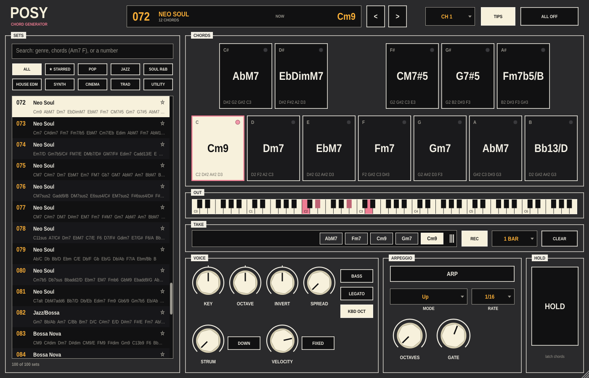

# Posy

A chord generator for Ableton Live. Posy plays one chord at a time from a set
of twelve, one per key of the octave, and sends it out as MIDI: straight, strummed,
held, or arpeggiated. Put any instrument after it and play pads, keys or plucks
with one finger.

It ships with **100 chord sets** (pop, jazz, neo soul, gospel, house, synthwave,
cinematic, classical and more), each a hand-voiced palette of twelve chords that
belong together. Find one in seconds with the search box, keep favourites with a
star, and drag what you played straight into a clip.

Posy makes no sound itself. It's MIDI only.



## What's on the panel

**SETS** — every chord set, searchable.
- Type to filter. Words match genres (`house`, `bossa`), chord names (`Am7`,
  `F#m9`, `/G`, `sus4`) and set numbers (`42`). Every word must match, so
  `Dm7 G7 jazz` finds jazz sets containing both chords. Flats and sharps are
  the same thing (`Bb` finds `A#`), and `maj7` finds `M7`.
- Up / Down step through the results while you type; Esc clears.
- Genre buttons narrow the list; **STARRED** shows the sets you've starred
  (click the star on a row). Stars are remembered for every Posy on the machine.
- `<` and `>` in the header step through the list as filtered.

**CHORDS** — the twelve chords of the set, laid out like an octave of a
keyboard with the sharps above. Click to play, drag across to move between
chords. Each pad shows the chord name (transposed with KEY) and the notes it
will send. Higher on a pad plays louder, unless FIXED velocity is on.

A MIDI keyboard on Posy's track plays the same chords: C plays the C pad, C#
the C# pad, and so on in every octave. With **KBD OCT** on, the octave you play
in moves the chord (C3 is home); off, every octave plays the same chord.
Mod wheel, pitch bend, sustain and other controllers pass straight through.

Keys stack: the last one pressed plays, and letting it go returns to the one
you're still holding.

**OUT** — every note going out right now.

**TAKE** — the chords you've played, in order (playing the same chord twice in
a row counts once). **Drag the strip onto a clip slot in Live** to drop them in
as a MIDI clip, one chord per LENGTH (½ bar, 1 bar or 2 bars). Right-click a
chord to remove it; CLEAR empties the take; REC stops collecting. The take is
saved with the Live set.

**VOICE** — shape every chord:
- **KEY** transposes by semitones, **OCTAVE** by octaves.
- **INVERT** rotates the voicing: right lifts the lowest note an octave, left
  drops the highest.
- **SPREAD**: Close (as stored), Open (second note up an octave), Wide (every
  other note up an octave).
- **BASS** doubles the lowest note an octave below.
- **LEGATO** keeps notes two chords share ringing instead of restriking them.
- **STRUM** spreads a chord's notes out in time (up to 200 ms); **DOWN** strums
  from the top.
- **VELOCITY** with **FIXED**: every chord at one velocity, or the keyboard's
  own velocity.

Turning these while a chord is playing re-voices it on the spot.

**ARPEGGIO** — **ARP** plays the chord one note at a time.
- **MODE**: Up, Down, Up & Down, Down & Up, Up & Down + (repeats the top and
  bottom), Converge (outside in), Random, and Chord (restrikes the whole chord
  every step, for rhythmic stabs).
- **RATE**: 1/1 to 1/32, with triplets.
- **OCTAVES**: climb 1–4 octaves. **GATE**: how long each note lasts.
- While Live is playing the arp locks to its grid (SYNCED). When Live is
  stopped it free-runs at Live's tempo (FREE), so you can still jam.

**HOLD** — latch the chord: it keeps playing after you let go, until you play
another or turn HOLD off. Works with the arp too.

**ALL OFF** stops every note and lets go of a held chord.

Every knob and button is a host parameter, including the chord set, so you can
automate set changes in an arrangement.

## Using it in Live

1. Put **Posy** on a MIDI track (it's under Plug-Ins as an instrument).
2. On a second MIDI track with your instrument, set **MIDI From** to the Posy
   track, choose **Posy** in the second menu, and set Monitor to **In**.
3. Play the pads or arm Posy's track and play your keyboard.

To capture chords as a clip, either drag the TAKE strip onto a clip slot, or
arm the instrument track and record.

## Building

You need CMake 3.22+ and a C++20 compiler (Xcode on macOS, Visual Studio 2022
on Windows). JUCE 8.0.9 is downloaded on first configure.

```sh
cmake -B build -DCMAKE_BUILD_TYPE=Release
cmake --build build --config Release
ctest --test-dir build -C Release
```

On macOS and Linux the plugin is copied into your VST3 folder after each build
(`~/Library/Audio/Plug-Ins/VST3`, `~/.vst3`); turn that off with
`-DPOSY_COPY_PLUGIN=OFF`. Use a local JUCE checkout with
`-DPOSY_JUCE_DIR=/path/to/JUCE`. For a universal Mac binary add
`-DCMAKE_OSX_ARCHITECTURES="arm64;x86_64"`.

`-DPOSY_BUILD_TOOLS=ON` also builds `PosySnapshot`, which renders the panel to
a PNG without a host. The screenshot above is
`PosySnapshot docs/posy.png 72 0` (set 72, C pad pressed).

### Releases

`.github/workflows/build.yml` builds and tests macOS, Windows and Linux when you
run it from the Actions tab. Run it on a `v*` tag matching
`project(Posy VERSION ...)` in `CMakeLists.txt` and it creates a draft release
with the three archives attached.

## Where things are saved

Settings (tooltips, starred sets):
- macOS: `~/Library/Application Support/Posy/Posy.settings`
- Windows: `%APPDATA%\Posy\Posy.settings`
- Linux: `~/.config/Posy/Posy.settings`

Everything else (the set, the knobs, the take) is saved with the Live set.

## Licence

GNU Affero General Public License v3.0. See [LICENSE](LICENSE).
